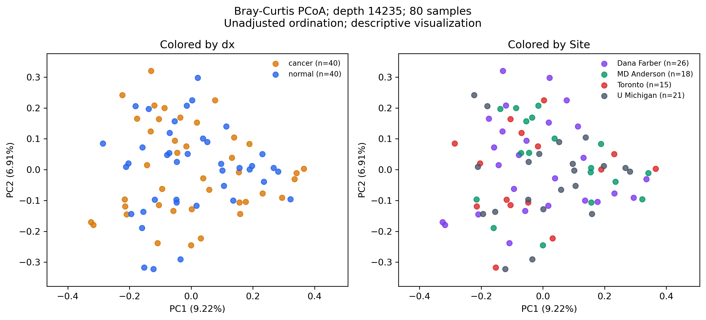
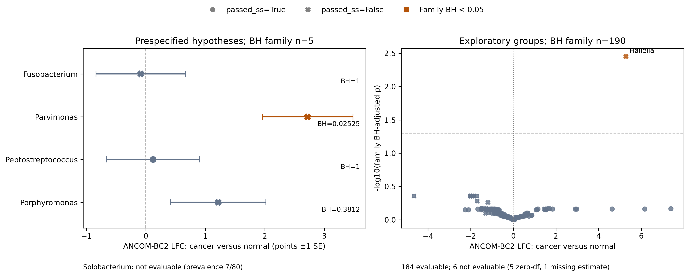

# Stool microbiome and colorectal cancer: a 16S reanalysis with QIIME 2

I reanalysed public 16S rRNA stool data from Baxter et al. (2016) to work
through a complete amplicon analysis, from raw reads to statistics, with
QIIME 2, DADA2 and R. I wrote the analysis plan before looking at any
result and logged each decision when I made it.

This is a learning project on a subset of a published cohort, not a new
finding. I am sharing it to show how I work: plan first, write down the
decisions, and report what the data show, including when the answer is
"no clear difference".

## Summary

**Question.** Does the overall bacterial community in stool differ between
people with colorectal cancer (CRC) and people without colonic lesions?

**Data.** 80 stool samples (40 CRC, 40 controls) drawn at random from
SRA study SRP062005. 16S V4 region, Illumina MiSeq, paired-end.

**What I found.**

1. Overall community composition was not clearly associated with CRC.
   Bray-Curtis PERMANOVA, adjusted for age, gender, BMI and study site:
   R² = 0.013, p = 0.42. Jaccard distances gave the same answer (p = 0.47).
2. The CRC samples were somewhat more spread out than the controls
   (PERMDISP, p = 0.04).
3. I named five genera in advance from the literature. One of them,
   *Parvimonas*, was higher in CRC after correction for multiple testing
   (adjusted p = 0.025). Three showed no clear difference and one was too
   rare to test.
4. Among 190 other genus-level groups, one (*Hallella*) passed correction
   (adjusted p = 0.004).
5. Both of these genus results failed ANCOM-BC2's built-in sensitivity
   check, so I treat them as tentative.

With 80 samples, a null result on the main question does not show that
there is no difference. It shows that this subset did not detect one.



*Bray-Curtis PCoA, 80 samples, rarefied to 14,235 reads. Left: coloured by
diagnosis. Right: coloured by study site. PC1 explains 9.2% and PC2 6.9%.
The plot is unadjusted and only for orientation; the test is the PERMANOVA
below.*

## Data and design

| | |
|---|---|
| Source | Baxter et al. 2016, *Genome Medicine* 8:37 |
| Accession | SRA SRP062005 |
| Original cohort | 490 participants: 120 CRC, 198 adenoma, 172 without colonic lesions |
| This analysis | 80 samples: 40 CRC, 40 controls |
| Controls | "Normal" and "High Risk Normal" as defined by the study. No colonic lesions; not necessarily healthy in other respects. |
| Not used | Adenoma samples |

**Why 80 samples.** I planned to process the whole CRC and control cohort.
I ran out of time before starting a full-time job, so I used the fallback
rule written into the plan: a random subset, 40 per group, with a recorded
seed (20261111). Only samples with a single sequencing run were eligible
(113 CRC, 157 controls). The list of 80 was committed to git before I
downloaded any of the reads (commit `6a6d25b`).

**Samples per site.**

| Site | CRC | Control | Total |
|---|---:|---:|---:|
| Dana Farber | 20 | 6 | 26 |
| MD Anderson | 9 | 9 | 18 |
| Toronto | 6 | 9 | 15 |
| U Michigan | 5 | 16 | 21 |
| Total | 40 | 40 | 80 |

The groups are balanced overall but not within sites. For that reason site
is a covariate in every model and the permutations are restricted to
within-site swaps. I did not redraw the sample to fix the imbalance.

## Methods

| Step | Tool | Main settings | Scripts |
|---|---|---|---|
| Select samples | Python | random within diagnosis, seed 20261111 | 05 |
| Download and verify | ENA FTP | 160 FASTQ files, 1.09 GiB, size and MD5 checked | 06-08 |
| Import | QIIME 2 | paired-end manifest, Phred33 | 09-10 |
| Primer check | Python | first 1,000 reads per file: no primers at read start | 11 |
| Trim read-through | q2-cutadapt | 3' adapters only, error rate 0.1, overlap 12 | 12 |
| Denoise | DADA2 `denoise-paired` | truncate 240 (forward) / 200 (reverse), max EE 2/2, min overlap 12, consensus chimera removal | 13-14 |
| Taxonomy | `classify-sklearn` | SILVA 144 NR99, V4 515f-806r classifier, confidence 0.7 | 15 |
| Tree | MAFFT, FastTree | midpoint-rooted | 16 |
| Rarefy | QIIME 2 | 14,235 reads per sample, seed 20261112 | 17-18 |
| Distances | QIIME 2 | Bray-Curtis (primary), Jaccard (sensitivity) | 19 |
| PERMANOVA | vegan `adonis2` | `distance ~ dx + Age + Gender + BMI + Site`, marginal terms, 9,999 permutations within site, seed 20261011 | 20, 21, 23 |
| Dispersion | vegan `betadisper` | distance to spatial median, same permutations | 22 |
| Differential abundance | ANCOM-BC2 | genus level, same covariates, present in at least 8 of 80 samples, unrarefied counts | 25-36 |
| PCoA | QIIME 2, matplotlib | Bray-Curtis | 37-38 |
| Alpha diversity | QIIME 2 | observed features, Shannon; descriptive only | 39-40 |

The rarefied table is used for the diversity analyses only. ANCOM-BC2 gets
the unrarefied counts.

**Multiple testing.** Benjamini-Hochberg at 0.05, applied separately to two
families: the five prespecified genera (n = 5) and all other eligible
groups (n = 190). I make no claim of error control across both together.

**Software.** QIIME 2 amplicon distribution 2026.7 (Python 3.12.13,
scikit-learn 1.7.1), R 4.5.2, vegan 2.7.3, permute 0.9.10, ANCOMBC 2.12.0
through q2-composition 2026.7.0. Run on a laptop with 16 GB RAM.

## Results

### Read processing

| Stage | Read pairs | % of DADA2 input |
|---|---:|---:|
| Raw | 4,175,507 | |
| After read-through trimming (DADA2 input) | 4,169,307 | 100 |
| Passed filter | 3,727,576 | 89.4 |
| Denoised | 3,696,426 | 88.7 |
| Merged | 3,620,484 | 86.8 |
| Non-chimeric | 3,565,583 | 85.5 |

All 80 samples were kept and none fell below my 50% review threshold.
The final table has 3,090 ASVs. Reads per sample ranged from 14,235 to
203,497 (median 36,563).

I rarefied to 14,235, the highest depth that keeps all 80 samples. That
uses 32% of the reads. Going to 20,000 would have cost 7 samples.

### Community composition (primary analysis)

Marginal PERMANOVA on Bray-Curtis distances, 80 samples, 9,999
permutations within site.

| Term | Df | R² | pseudo-F | p |
|---|---:|---:|---:|---:|
| **Diagnosis (CRC vs control)** | 1 | 0.0127 | 1.02 | 0.421 |
| Age | 1 | 0.0128 | 1.03 | 0.395 |
| Gender | 1 | 0.0147 | 1.18 | 0.172 |
| BMI | 1 | 0.0175 | 1.40 | 0.040 |
| Site | 3 | 0.0401 | 1.07 | not interpreted |
| Residual | 72 | 0.8988 | | |

Diagnosis explained about 1.3% of the variation and was not significant.
The other rows are shown for context. BMI was not one of my hypotheses.
The site p-value has no meaning here because the permutations never move
samples between sites. The R² values are marginal and do not add up to a
partition of the variance.

Sensitivity analysis with Jaccard distances, same model: diagnosis
R² = 0.0125, pseudo-F = 1.00, p = 0.467.

### Dispersion

PERMDISP on the same Bray-Curtis distances: F = 3.86, p = 0.040.
Mean distance to the group median was 0.549 for CRC and 0.524 for controls.

So CRC samples differed more from each other than controls did. This is a
statement about spread, not about the two groups sitting in different
places, and this test is not adjusted for age, gender or BMI.

### Genus-level differential abundance (secondary analysis)

Collapsing the taxonomy to genus gave 426 groups. 194 met the eligibility
rules (present in at least 8 of 80 samples, with a usable genus label).
188 of those could be evaluated in the end (see below).

**The five genera named in advance.** All were expected to be higher in
CRC, based on the meta-analysis of Wirbel et al. (2019).

| Genus | Samples with reads | Log fold change (CRC vs control) | SE | p | Adjusted p (n = 5) | Sensitivity check |
|---|---:|---:|---:|---:|---:|---|
| *Fusobacterium* | 24 / 80 | -0.08 | 0.75 | 0.912 | 1.000 | failed |
| ***Parvimonas*** | 18 / 80 | **+2.72** | 0.76 | 0.005 | **0.025** | failed |
| *Peptostreptococcus* | 12 / 80 | +0.12 | 0.78 | 0.884 | 1.000 | passed |
| *Porphyromonas* | 21 / 80 | +1.22 | 0.80 | 0.152 | 0.381 | failed |
| *Solobacterium* | 7 / 80 | not tested | | | | |

*Solobacterium* was below the prevalence threshold. I did not lower the
threshold or swap in another genus.

**Exploratory family.** One of the 190 other groups passed correction:
*Hallella*, log fold change +5.28 (SE 0.78), adjusted p = 0.0035, present
in 20 of 80 samples.

**How far I trust these two results.** *Parvimonas* is in the expected
direction and has been reported in CRC many times, which fits. But both
results failed ANCOM-BC2's pseudo-count sensitivity check (`passed_ss` =
FALSE): the result depends on how zeros are handled. Both genera are absent
from most samples. I report them as associations that passed correction in
this subset and need confirmation in more samples, not as established
differences.

The log fold changes are natural-log, model-based estimates from ANCOM-BC2.
They are not ratios of relative abundance.



*Left: the four prespecified genera that could be tested, estimate ± 1 SE
(not a 95% confidence interval). Right: the exploratory groups.*

**Six groups that could not be evaluated.** The first version of this
figure showed a group with a log fold change near 29 and an adjusted p of
1. I traced it to the model, not the biology. Five groups were present in
exactly 8 samples. The model has 8 coefficients, so there were no residual
degrees of freedom, and the software sets the missing p-value to 1. A sixth
group had no estimate at all. I report these six as "not evaluable"
instead of "not significant", kept the two family sizes at 5 and 190, and
checked that no other adjusted p-value changed. The affected groups are
*Paludihabitans*, *Phocea*, *Thermanaerosceptrum*, *Eubacterium*,
*Leuconostoc* and S5-A14a.

### Alpha diversity

Observed ASVs and Shannon diversity for all 80 samples, pooled, on the
rarefied table:

| Metric | Minimum | Q1 | Median | Q3 | Maximum |
|---|---:|---:|---:|---:|---:|
| Observed ASVs | 73 | 149 | 180 | 227 | 361 |
| Shannon | 4.26 | 5.33 | 5.65 | 6.04 | 6.71 |

I added this after the other results were known, so it is descriptive
only: no comparison between groups and no p-value. Per-sample values are
in `reports/main_alpha_14235/`.

## Limitations

- **Small subset.** 80 of 270 eligible samples. Power is low, and the null
  result on the main question should be read with that in mind.
- **Site imbalance.** Dana Farber contributed 20 CRC and 6 controls;
  U Michigan 5 and 16. Adjusting for site helps but cannot fully separate
  site from diagnosis.
- **Sequencing batch is unknown.** The paper reports three MiSeq runs. I
  could not find which sample was on which run, so I could not model batch
  and I let DADA2 learn one error model for all 80 samples. DADA2
  recommends one per run. Site is not the same thing as batch.
- **Single-run samples only.** Samples that were sequenced more than once
  were excluded from the draw. That may have shifted the selection.
- **One sample per person is assumed, not verified.** The public metadata
  has no participant ID.
- **Some settings were fixed late.** The plan fixed the main model and the
  five genera before any result. The sampling depth was chosen from library
  sizes only. The ANCOM-BC2 details (prevalence threshold, exact settings)
  were written down before the first fit but after I had seen the
  community-level results. The log says so for each entry.
- **Taxonomy.** A V4 fragment often cannot separate close genera. The genus
  labels are database annotations, not confirmed identifications.
- **Cross-sectional data.** Nothing here says anything about cause.

## Repository layout

```
PLAN.md                  analysis plan, written before any result (git tag plan-v1)
confirmatory_genera.md   the five genera named in advance, with their source
DECISIONS_LOG.md         each decision, dated, with my reasoning
scripts/                 numbered scripts in run order (see scripts/README.md)
metadata/                sample lists and sample metadata (see metadata/README.md)
reports/                 QC tables, test outputs, and my notes from each course module
figures/                 figures
environment.yml          conda environment
```

Raw reads and QIIME 2 artifacts (`.qza`, `.qzv`) are not in the repository.
They are large and the scripts rebuild them.

Where to find the main numbers:

| Result | File |
|---|---|
| DADA2 retention per sample | `reports/main_dada2_per_sample_QC.tsv` |
| Rarefaction depth trade-offs | `reports/main_depth_tradeoffs.tsv` |
| PERMANOVA, PERMDISP, Jaccard | `reports/main_primary/` |
| ANCOM-BC2, final audited table | `reports/main_ancombc2/dx_cancer_final_audited.tsv` |
| PCoA coordinates | `reports/main_braycurtis_pcoa/` |

## Reproducing the analysis

1. Create the environment: `conda env create -f environment.yml`
2. Put the two source tables in `metadata/original/` (links in
   `metadata/README.md`).
3. Download the pre-trained SILVA 144 V4 classifier (515f-806r, uniform
   weights, built for QIIME 2 2026.7). The exact link is in
   `reports/M4_taxonomy_summary.md`.
4. Run the scripts in `scripts/` in number order from the repository root.

Scripts 05 to 40 cover the 80-sample analysis. On my laptop DADA2 took 41
minutes with two threads; taxonomy and the tree took about a minute each.
Some scripts and the import manifest contain absolute paths from my
machine and need adjusting.

## How I worked

**Plan before results.** `PLAN.md` (git tag `plan-v1`) and
`confirmatory_genera.md` were committed before I produced any result split
by diagnosis. An 8-sample pilot came first and was used for technical
checks only.

**Decision log.** `DECISIONS_LOG.md` records each choice with my reasoning.
Changes to the plan are dated amendments that state whether I had already
seen results. Mistakes are logged too, not erased. For example, I first
collapsed the taxonomy at level 6 and got families instead of genera,
because this SILVA version has an extra rank. The wrong script is still
in the repository, marked as unused.

**Module notes.** The files `reports/M2_checkpoint.md` to
`reports/M8_main_alpha_diversity_summary.md` are my notes from each stage.
Most stages ended with five questions I had to answer in my own words; the
notes record the result, including the answers I got wrong.

**What git does and does not show.** The plan and the list of 80 samples
have their own commits from before the data were processed. The later
scripts, log entries and outputs were committed together at the end, so
for those the commit history shows only the final state.

**Use of AI.** I did this as a self-study course of about five weeks with
AI assistants as tutors. They explained concepts, drafted most of the
script code and questioned my choices. I made and justified the analysis
decisions, ran everything on my own laptop, checked the outputs, and I can
explain each step and parameter.

## What I learned

- Check the rank structure of a taxonomy before collapsing it. "Level 6"
  is not always genus.
- A very large effect with p = 1 is a reason to look at the model. Here it
  was a group with no residual degrees of freedom.
- PERMANOVA and PERMDISP answer different questions, and a PCoA plot
  proves neither.
- Study site and sequencing batch are different things. Without the run
  information I can state the problem but not fix it.
- Freezing the sample list and the hypotheses in git before touching the
  data is cheap and makes the result much easier to defend.
- Practical things: verifying downloads by MD5, running long jobs
  unattended with logs, and writing scripts that stop on errors.

## References

- Baxter NT, Ruffin MT, Rogers MAM, Schloss PD. Microbiota-based model
  improves the sensitivity of fecal immunochemical test for detecting
  colonic lesions. *Genome Medicine* 2016;8:37.
  doi:10.1186/s13073-016-0290-3
- Wirbel J, et al. Meta-analysis of fecal metagenomes reveals global
  microbial signatures that are specific for colorectal cancer.
  *Nature Medicine* 2019;25:679-689. doi:10.1038/s41591-019-0406-6
- Bolyen E, et al. Reproducible, interactive, scalable and extensible
  microbiome data science using QIIME 2. *Nature Biotechnology*
  2019;37:852-857.
- Callahan BJ, et al. DADA2: high-resolution sample inference from
  Illumina amplicon data. *Nature Methods* 2016;13:581-583.
- Lin H, Peddada SD. Multigroup analysis of compositions of microbiomes
  with covariate adjustments and repeated measures. *Nature Methods*
  2024;21:83-91.
- Oksanen J, et al. vegan: Community Ecology Package.
- Quast C, et al. The SILVA ribosomal RNA gene database project.
  *Nucleic Acids Research* 2013;41:D590-D596.

## Author

Hamidreza (Reza) Yazdanpanah, MSc Biotechnology, Munich.
Questions and corrections are welcome through the issue tracker.
